I build web software end to end, from the database to the model: PHP, Laravel and WordPress
on the backend, a modern frontend, and AI tooling woven into the daily work.

→ [ismetozkan.com](https://ismetozkan.com) · [LinkedIn](https://www.linkedin.com/in/ismetozkan/)

### $ cat toolkit

| | |
|---|---|
| **Languages** | PHP · JavaScript · TypeScript · HTML · CSS / SCSS |
| **Frameworks** | Laravel · WordPress · WooCommerce · Svelte |
| **AI** | Claude Code · Codex · OpenCode · Cursor · Grok Bot · OpenAI & Gemini APIs · MCP integrations · AI tooling & automation |
| **Frontend** | Tailwind CSS · Bootstrap · Twig · Blade · WCAG |
| **Backend & data** | REST APIs · OOP · MySQL · Relational databases · Redis · Queues & Cron · PHPUnit / Pest |
| **DevOps** | Docker · GitHub Actions · Nginx · Linux · Git |

### $ cat hobbies

Singing · [Photography](https://ismetozkan.com/photos/) · Guitar · Painting · Beer brewing · Reptiles · Camping · Microcontrollers
